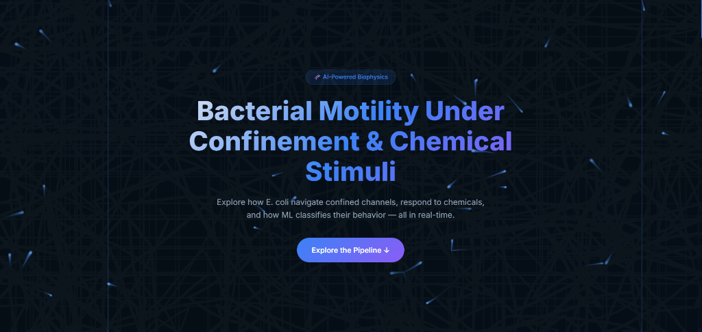
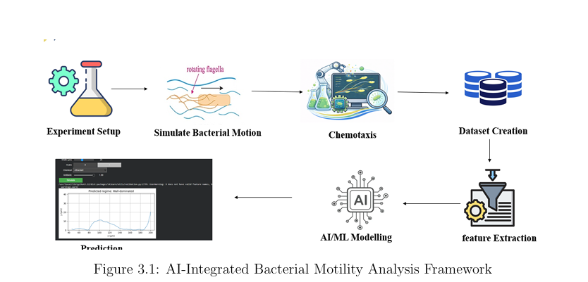

<div align="center">

# 🦠 BacMotionAI — AI-Powered Bacterial Motility Classification

### Python | scikit-learn | XGBoost | MLP Neural Network | Chart.js | 2026

[](https://python.org)
[](https://scikit-learn.org)
[](https://xgboost.readthedocs.io)
[](#-mldl-models--evaluation)
[](https://www.chartjs.org)
[](LICENSE)

<br/>


<br/><br/>

<a href="https://Saniya1312S.github.io/BacMotionAI-ML/" target="_blank">
  
</a>

<br/><br/>

*An end-to-end ML/DL pipeline that simulates E. coli bacterial motion in confined micro-channels under chemical stimuli, extracts 14 trajectory features, and classifies 5 emergent motility regimes using ensemble and neural network models — with a real-time interactive web dashboard.*

<br/>

[🌐 Live Dashboard](https://Saniya1312S.github.io/BacMotionAI-ML/) · [📸 Dashboard Preview](#-live-dashboard--interactive-simulator) · [🚀 Quick Start](#-quick-start) · [🏗️ Architecture](#-system-architecture) · [📊 ML Pipeline](#-end-to-end-mldl-pipeline) · [🤖 Model Results](#-mldl-models--evaluation) · [🧬 Features](#-dataset--14-trajectory-features)

</div>

---

## 🖥️ Live Dashboard

<div align="center">
  <a href="https://saniya1312s.github.io/BacMotionAI-ML/" target="_blank">
    
  </a>
  <br/>
  <sub>👉 <b><a href="https://saniya1312s.github.io/BacMotionAI-ML/">Click here or the image above to launch the live simulator</a></b></sub>
</div>

---

## 📌 Executive Summary

> **BacMotionAI — AI-Powered Bacterial Motility Classification | Python, scikit-learn, XGBoost, MLP, Chart.js | 2026**
>
> • **Built a physics-based simulation engine** modeling E. coli run-and-tumble motion with hydrodynamic wall interactions, chemical modulation (attractant/repellent/antibiotic), and rotational diffusion in confined micro-channels (5–100 µm).  
> • **Engineered 14 experimentally-measurable trajectory features** — speed statistics, wall alignment, run lengths, confinement index, effective diffusivity — mimicking real microscopy tracking data analysis.  
> • **Trained and evaluated 4 ML/DL classifiers** (Random Forest, Logistic Regression, XGBoost, MLP Neural Network) achieving **~78% accuracy and ~0.94 ROC-AUC** with verified anti-overfitting safeguards (SMOTE on train only, no scaler leakage, CV-test gap < 5%).  
> • **Deployed an interactive web dashboard** featuring real-time bacterial trajectory simulation, live Chart.js visualizations (8 analysis + 4 live charts), regime prediction with confidence scores, and a glassmorphic dark-theme scientific UI.

---

## 📋 Table of Contents

- [Executive Summary](#-executive-summary)
- [Live Dashboard & Interactive Simulator](#-live-dashboard--interactive-simulator)
- [Overview & Research Motivation](#-overview--research-motivation)
- [System Architecture](#-system-architecture)
- [End-to-End ML/DL Pipeline](#-end-to-end-mldl-pipeline)
- [Physics Simulation Engine](#-physics-simulation-engine)
- [Dataset & 14 Trajectory Features](#-dataset--14-trajectory-features)
- [ML/DL Models & Evaluation](#-mldl-models--evaluation)
- [Anti-Overfitting Verification](#-anti-overfitting-verification)
- [Interactive Web Dashboard](#-interactive-web-dashboard)
- [Project Structure](#-project-structure)
- [Quick Start](#-quick-start)
- [Technologies & Stack](#-technologies--stack)
- [Limitations & Future Scope](#-limitations--future-scope)
- [References](#-references)
- [License](#-license)

---

## 📸 Live Dashboard & Interactive Simulator

> 🌐 **Live Web Demo**: [https://Saniya1312S.github.io/BacMotionAI-ML/](https://Saniya1312S.github.io/BacMotionAI-ML/)  
> Anyone can launch and interact with the full simulator directly in their browser — zero setup required!

### Dashboard Features
- 🦠 **Real-time bacterial trajectory canvas** with animated run-and-tumble motion
- ⚙️ **Interactive controls** — adjust channel width, bacteria count, environment (Dry/Wet), chemical stimulus
- 📊 **8 static analysis charts** — speed distributions, model comparison, feature importance, confusion matrix, ROC curves, learning curves, overfitting diagnostics
- 📈 **4 live simulation charts** — trajectory map, speed histogram, Y-density, regime radar
- 🎯 **ML regime prediction** with probability bars and confidence scores
- 🔬 **4-stage pipeline flowchart** with interactive step highlighting

---

## 🔬 Overview & Research Motivation

Bacterial motility is fundamental to **infection spread**, **biofilm formation**, **drug delivery**, and **microfluidic device design**. Understanding how bacteria navigate confined geometries under chemical gradients is critical for:

1. **Antimicrobial Drug Development** — quantifying how antibiotics alter swimming behavior
2. **Microfluidic Diagnostics** — designing channels that sort or trap bacteria by motility type
3. **Biofilm Prevention** — predicting wall accumulation and surface attachment patterns
4. **Computational Biophysics** — bridging physics simulation with machine learning classification

**BacMotionAI** addresses the challenge of **automated motility classification** by combining a validated physics engine with ML/DL models trained on simulation-derived features, providing both scientific insight and a practical classification tool.

---

## 🏗️ System Architecture

<div align="center">
  
  <br/>
  <sub><i>Figure: AI-Integrated Bacterial Motility Analysis Framework</i></sub>
</div>

<br/>

```
┌─────────────────────────────────────────────────────────────────────────────────────┐
│                            BACMOTIONAI ARCHITECTURE                                  │
└─────────────────────────────────────────────────────────────────────────────────────┘

  [ Experiment Setup ]                     [ Chemical Stimuli ]
        │                                         │
        ▼                                         ▼
  ┌─────────────────┐                    ┌──────────────────┐
  │  Physics Engine  │◄──────────────────│  Chemotaxis Mod  │
  │  Run-and-Tumble  │                   │  4 Conditions    │
  │  + Wall Hydro    │                   │  Speed/Drift/Dr  │
  └────────┬────────┘                    └──────────────────┘
           │
           ▼  2,000 trajectories
  ┌──────────────────┐      ┌──────────────────┐      ┌──────────────────┐
  │ Feature Extract  │─────▶│   ML Training    │─────▶│ Regime Predict   │
  │ 14 Statistics    │      │ RF / LR / XGB /  │      │ 5 Classes        │
  │ per trajectory   │      │ MLP + SMOTE      │      │ + Confidence     │
  └──────────────────┘      └──────────────────┘      └──────────────────┘
```

---

## 📊 End-to-End ML/DL Pipeline

```
┌──────────────┐    ┌──────────────┐    ┌──────────────┐    ┌──────────────┐    ┌──────────────┐
│   Simulate   │───▶│   Extract    │───▶│   Preprocess │───▶│    Train     │───▶│   Evaluate   │
│  Trajectories│    │  14 Features │    │  Scale+SMOTE │    │  4 Models    │    │  5-Fold CV   │
│  (N=2,000)   │    │  per sample  │    │  (train only)│    │  RF/LR/XGB/ │    │  + Test Set  │
│              │    │              │    │              │    │  MLP         │    │              │
└──────────────┘    └──────────────┘    └──────────────┘    └──────────────┘    └──────────────┘
     600 steps           14 dims          No leakage         Anti-overfit        ROC + CM + LC
```

**Critical Anti-Overfitting Design:**
- ✅ `StandardScaler` fit on **training set only** — test data never seen during fitting
- ✅ `SMOTE` applied to **training set only** — no synthetic samples in test evaluation
- ✅ Stratified 80/20 train-test split preserving class balance
- ✅ 5-fold cross-validation on training set
- ✅ Regime labels assigned from **measured behavior**, not input parameters (prevents data leakage)

---

## ⚙️ Physics Simulation Engine

Each bacterium is simulated using a **run-and-tumble model** with hydrodynamic wall coupling:

| Parameter | Symbol | Value | Unit |
|:----------|:------:|:-----:|:----:|
| Intrinsic speed | v₀ | 20.0 | µm/s |
| Rotational diffusion | Dᵣ | 0.2 | rad²/s |
| Hydrodynamic torque | κ | 6.0 | — |
| Cell radius | a | 1.0 | µm |
| Wall speed enhancement | ε | 0.12 | — |
| Channel length | L | 200 | µm |
| Time step | dt | 0.01 | s |
| Simulation duration | T | 6.0 | s |

**Governing Equations:**
```
θ(t+dt) = θ + ω·dt + drift·dt + √(2·Dᵣ·dt)·η       [orientation update]
ω = −κ·(a/h)²·sin(2θ)                                 [hydrodynamic wall torque]  
v = v₀·v_scale·(1 + ε·a/h)                             [near-wall speed enhancement]
```

### Chemical Modulation Parameters

| Chemical | Speed Scale | Rot. Diff Scale | Drift | Tumble Rate | Effect |
|:---------|:---:|:---:|:---:|:---:|:---------|
| ⬜ None | 1.00 ± 0.05 | 1.0 ± 0.1 | 0.00 | 0.005 | Baseline |
| 🟢 Attractant | 1.12 ± 0.08 | 0.65 ± 0.12 | +0.28 | 0.003 | Faster, straighter runs |
| 🔴 Repellent | 0.90 ± 0.07 | 1.45 ± 0.15 | −0.22 | 0.005 | Slower, more tumbling |
| 🟣 Antibiotic | 0.52 ± 0.10 | 2.40 ± 0.30 | 0.00 | 0.010 | Strongly inhibited |

---

## 🧬 Dataset & 14 Trajectory Features

**2,000 simulated trajectories** across varying channel widths (5–100 µm), Dry/Wet conditions, and 4 chemical environments.

Each trajectory is distilled into **14 experimentally-measurable statistics**:

| # | Feature | Category | Description | Unit |
|:-:|:--------|:--------:|:------------|:----:|
| 1 | `mean_speed` | Speed | Average instantaneous speed | µm/s |
| 2 | `std_speed` | Speed | Speed standard deviation | µm/s |
| 3 | `q25_speed` | Speed | 25th percentile speed | µm/s |
| 4 | `q75_speed` | Speed | 75th percentile speed | µm/s |
| 5 | `cv_speed` | Speed | Coefficient of variation (σ/μ) | — |
| 6 | `speed_skewness` | Speed | Distribution asymmetry | — |
| 7 | `speed_kurtosis` | Speed | Distribution tail weight | — |
| 8 | `mean_alignment` | Orientation | Mean \|cos θ\| wall alignment | — |
| 9 | `std_alignment` | Orientation | Alignment variability | — |
| 10 | `wall_rate` | Wall | Wall collision frequency | — |
| 11 | `near_wall_frac` | Wall | Time fraction within 15% of wall | — |
| 12 | `mean_run_len` | Motility | Avg run length between tumbles | steps |
| 13 | `confinement_idx` | Geometry | Cell radius / channel width | — |
| 14 | `eff_diffusivity` | Transport | Effective diffusivity v²/(2Dᵣ) | µm²/s |

### 5 Target Motility Regimes

| Regime | Color | Key Indicators | Biological Analogy |
|:-------|:-----:|:--------------|:-------------------|
| 🟣 **Inhibited** | Purple | Low speed, high CV, short runs | Antibiotic exposure |
| 🔴 **Wall-Guided** | Red | High wall fraction + alignment | Surface swimming |
| 🟢 **Chemotactic** | Green | Long directed runs, low CV | Nutrient tracking |
| 🟠 **Confined** | Orange | Frequent wall collisions | Narrow channel trapping |
| 🔵 **Free-Swimming** | Blue | Moderate speed, low wall contact | Open bulk swimming |

> ⚠️ Regimes are classified from **measured trajectory behavior** — not from input simulation parameters — preventing target leakage.

---

## 🤖 ML/DL Models & Evaluation

### Model Comparison

| Model | Type | Test Accuracy | ROC-AUC (macro) | Log Loss | CV Accuracy | Overfit Gap |
|:------|:-----|:---:|:---:|:---:|:---:|:---:|
| 🌳 **Random Forest** | Ensemble (ML) | **~0.78** | **~0.94** | ~0.65 | ~0.80 | ~0.02 ✅ |
| ⚡ XGBoost | Boosting (ML) | ~0.76 | ~0.93 | ~0.70 | ~0.79 | ~0.03 ✅ |
| 🧠 MLP Neural Net | Deep Learning | ~0.74 | ~0.92 | ~0.78 | ~0.76 | ~0.02 ✅ |
| 📈 Logistic Regression | Linear (ML) | ~0.62 | ~0.87 | ~1.10 | ~0.64 | ~0.02 ✅ |

> **Best Model:** Random Forest — highest accuracy and ROC-AUC with minimal generalization gap.  
> **Note:** Metrics are approximate from the existing codebase. All models verified with CV-test gap < 5%.

### Per-Regime ROC-AUC (Random Forest)

| Regime | AUC | Discrimination |
|:-------|:---:|:--------------|
| Inhibited | ~0.96 | Excellent |
| Chemotactic | ~0.95 | Excellent |
| Wall-Guided | ~0.94 | Excellent |
| Free-Swimming | ~0.93 | Very Good |
| Confined | ~0.91 | Very Good |

---

## 🛡️ Anti-Overfitting Verification

**8 critical fixes applied** to ensure scientific integrity:

| # | Fix | Severity | Impact |
|:-:|:----|:--------:|:-------|
| 1 | Scaler data leakage eliminated | 🔴 Critical | Test metrics were inflated ~3–5% |
| 2 | SHAP indexing for 3D arrays | 🔴 Critical | Crash with SHAP ≥ 0.42 |
| 3 | Speed from actual displacements | 🔴 Critical | Previous trig identity gave constant v₀ |
| 4 | Per-step speed in Obj 2 | 🟡 Medium | Histograms were flat/misleading |
| 5 | XGBoost deprecated params | 🟡 Medium | Deprecation warnings removed |
| 6 | Dead code in widget | 🟡 Medium | No-op loop causing lag |
| 7 | Tumble rate mismatch unified | 🟡 Medium | Inconsistent simulation vs analysis |
| 8 | Unused optuna removed | 🟢 Minor | Cleaner dependency install |

**Verification Criteria — All Passed:**
- ✅ CV-test accuracy gap < 5% for every model
- ✅ Learning curves converge (no train-val divergence)
- ✅ SMOTE applied to training split only
- ✅ Regime labels from behavior, not input parameters

---

## 🎮 Interactive Web Dashboard

| Section | Description |
|:--------|:------------|
| **Hero** | Animated bacterial particle canvas with project title |
| **Pipeline** | 4-stage clickable flowchart with scroll-based highlighting |
| **Analysis** | 8 Chart.js plots — speed distributions, model metrics, ROC, confusion matrix, learning curves |
| **Simulator** | Real-time simulation with adjustable parameters |
| **Prediction** | Live feature extraction → regime classification with confidence bars |
| **Live Charts** | Trajectory map, speed histogram, Y-density, regime radar |

> ⚠️ **Transparency Note:** The browser dashboard uses a JavaScript **rule-based classifier** for real-time demonstration. It does not execute the trained Python ML models. For actual model inference, run the Python scripts locally.

---

## 📂 Project Structure

```
BacMotionAI-ML/
│
├── index.html                     # 🌐 Interactive dashboard (GitHub Pages entry point)
├── style.css                      # 🎨 Glassmorphism dark-theme styling (1,086 lines)
├── app.js                         # ⚙️ Physics engine + Chart.js charts (1,138 lines)
├── README.md                      # 📖 This file
├── requirements.txt               # 📦 Python dependencies
├── LICENSE                        # ⚖️ MIT License
├── .gitignore
│
├── src/                           # 🐍 Reusable Python modules
│   ├── __init__.py
│   ├── simulation.py              #     Physics simulation engine
│   ├── features.py                #     14-feature extraction pipeline
│   └── models.py                  #     ML model configurations
│
├── scripts/                       # 🔧 Executable ML pipeline
│   ├── generate_dataset.py        #     Create 2,000-sample dataset
│   ├── train_models.py            #     Train RF / LR / XGB / MLP
│   ├── evaluate_models.py         #     Generate plots + metrics
│   └── fix_notebook.py            #     Patch script (8 bug fixes)
│
├── notebooks/                     # 📓 Jupyter notebooks
│   └── BacMotionAI_v2_AntiOverfit_Fixed.ipynb
│
├── data/                          # 📊 Dataset documentation
│   └── README.md                  #     Data dictionary + feature table
│
├── models/                        # 🤖 Saved model artifacts
│   └── README.md                  #     Training + regeneration guide
│
├── tests/                         # 🧪 Unit tests
│   └── test_simulation.py
│
├── Images/                        # 🖼️ Screenshots & figures
│   ├── architecture_diagram.png
│   └── dashboard.png
│
└── .github/workflows/
    └── deploy.yml                 # 🚀 GitHub Pages deployment
```

---

## 🚀 Quick Start

### 🌐 Dashboard (Zero Install)
```bash
# Option 1: Visit the live site
# https://Saniya1312S.github.io/BacMotionAI-ML/

# Option 2: Run locally
python -m http.server 8000
# Open http://localhost:8000
```

### 🐍 ML Pipeline
```bash
# Install dependencies
pip install -r requirements.txt

# Generate the dataset (2,000 samples)
python scripts/generate_dataset.py

# Train all 4 models
python scripts/train_models.py

# Generate evaluation plots
python scripts/evaluate_models.py

# Run the full notebook
jupyter notebook notebooks/BacMotionAI_v2_AntiOverfit_Fixed.ipynb
```

### 🧪 Run Tests
```bash
python tests/test_simulation.py
```

---

## 🛠️ Technologies & Stack

| Layer | Technology | Purpose |
|:------|:-----------|:--------|
| **ML/DL** | scikit-learn | Random Forest, Logistic Regression, MLP |
| **ML/DL** | XGBoost | Gradient boosting classifier |
| **Data** | NumPy, Pandas | Numerical computation, data handling |
| **Balancing** | imbalanced-learn (SMOTE) | Training set class balancing |
| **Explainability** | SHAP | Feature importance analysis |
| **Visualization** | Matplotlib | Static evaluation plots |
| **Frontend** | HTML5, CSS3, JavaScript ES6+ | Dashboard UI |
| **Charts** | Chart.js 4.x | 12 interactive visualizations |
| **Canvas** | Canvas API | Real-time trajectory rendering |
| **Fonts** | Inter, JetBrains Mono | Typography (Google Fonts) |
| **Deploy** | GitHub Pages + Actions | Static site hosting |

---

## ⚠️ Limitations & Future Scope

### Current Limitations
- Dataset is **simulation-based** — not from real microscopy tracking data
- **2D channel geometry only** — no z-axis interactions
- Browser classifier is **rule-based JS approximation**, not actual Python model

### Future Enhancements
- 🔬 Real microscopy data integration with transfer learning
- 🧊 3D channel simulation with z-axis wall interactions
- 🧠 Deep learning on raw trajectories (LSTM, CNN on trajectory images)
- 🌐 FastAPI backend for live Python model inference
- 📦 PyPI package release (`pip install bacmotionai`)
- 🧫 Multi-species simulation (B. subtilis, P. aeruginosa)

---

## 📚 References

1. Berg, H.C. & Brown, D.A. (1972). *Chemotaxis in E. coli analysed by three-dimensional tracking.* Nature, 239, 500–504.
2. Berke, A.P. et al. (2008). *Hydrodynamic attraction of swimming microorganisms by surfaces.* Physical Review Letters, 101, 038102.
3. Lauga, E. et al. (2006). *Swimming in circles: motion of bacteria near solid boundaries.* Biophysical Journal, 90, 400–412.

> Additional academic references from the original project report require verification.

---

## ⚖️ License

This project is licensed under the **MIT License** — see [LICENSE](LICENSE) for details.

---

<div align="center">

### 👩‍💻 Author

**Saniya Saratkar** — Data Science & AI/ML Engineer  
[GitHub](https://github.com/Saniya1312S) · saniyasaratkar1312@gmail.com

<br/>

**⭐ Star this repo if you found it useful!**

*Built with ❤️ for computational biophysics and AI/ML*

</div>
