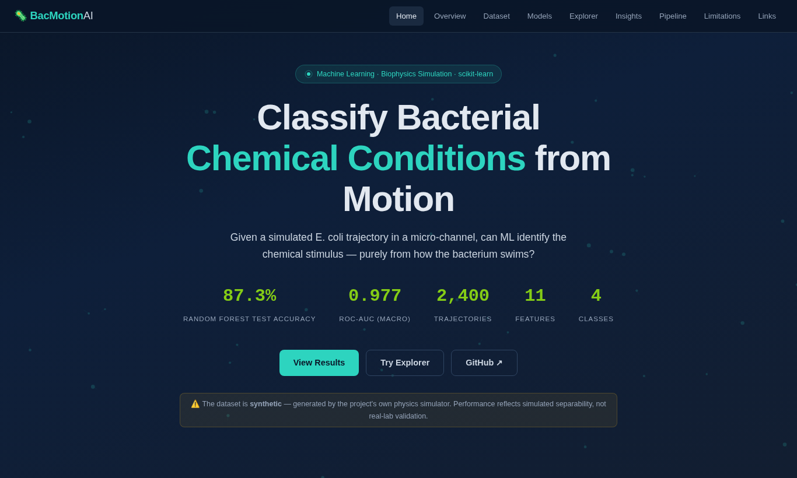
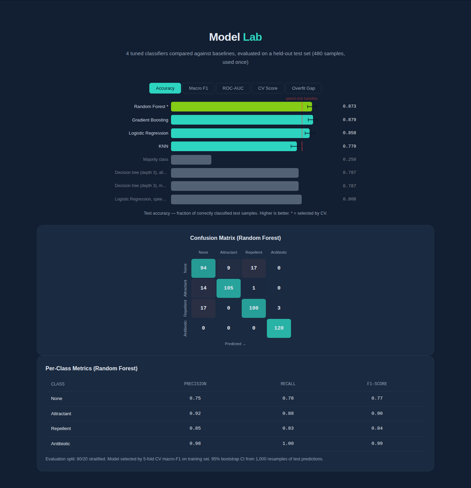
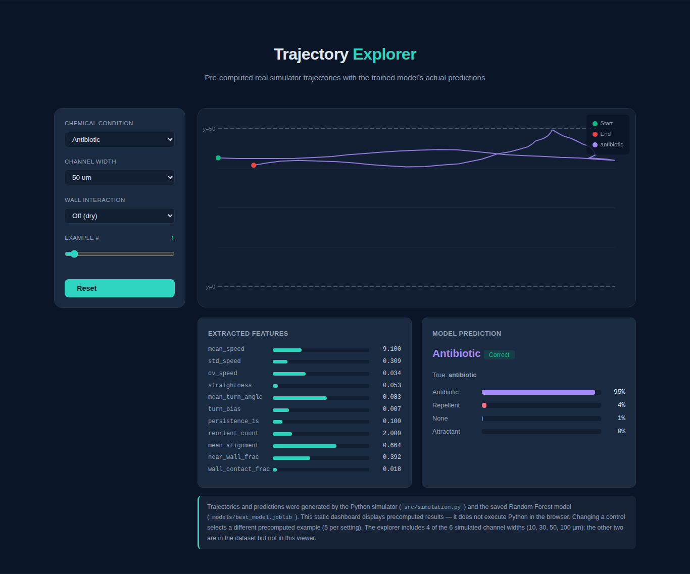
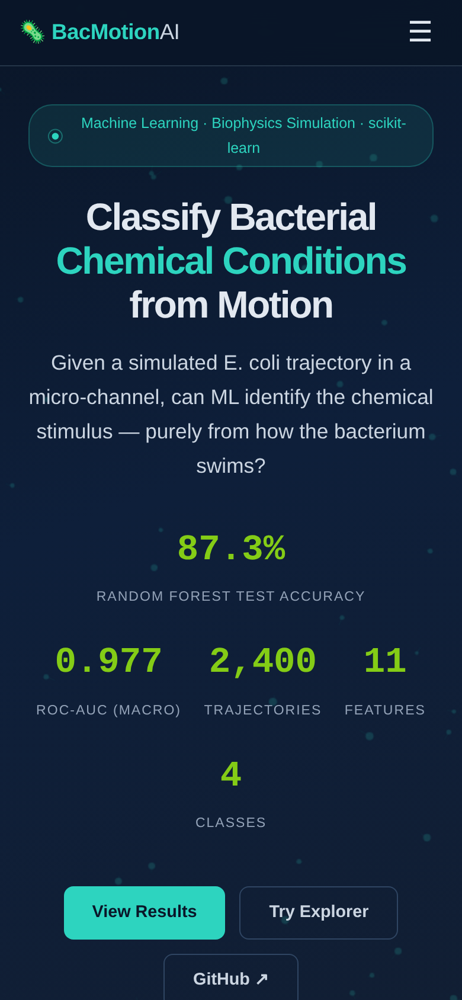

# 🦠 BacMotionAI - Classifying Bacterial Chemical Conditions from Motion

[](https://github.com/Saniya1312S/Bacterial-MotionAI-ML/actions)


**[🌐 Live Dashboard](https://saniya1312s.github.io/Bacterial-MotionAI-ML/)** - interactive science dashboard (model results, trajectory explorer, evaluation plots).
*The link works after GitHub Pages is enabled and the deploy workflow has succeeded - see [Section 9](#9-deploy-the-dashboard-to-github-pages).*

[](https://saniya1312s.github.io/Bacterial-MotionAI-ML/)

An end-to-end machine-learning project: **given the (x, y) path of one swimming bacterium, predict which chemical
condition it is in** - `none`, `attractant`, `repellent` or `antibiotic`.

The data is simulated, so I control the ground truth. The focus of the project is the **ML workflow**:
feature engineering, leakage-safe preprocessing, baselines, cross-validated tuning, honest evaluation and error analysis.

---

## 1. Results at a glance

| | |
|:--|:--|
| Task | 4-class classification (balanced, 600 samples per class) |
| Data | 2,400 simulated trajectories, 11 features, split 80% train / 20% test |
| Best model (chosen by cross-validation) | Random Forest |
| **Test accuracy** | **87.3%** (95% CI 84.2% - 90.2%), macro-F1 0.873 |
| Chance level / simple baseline | 25% / 80.8% (Logistic Regression on speed features only) |

### Baselines (test set)

| Baseline | Accuracy | Macro-F1 |
|:--|:-:|:-:|
| Majority class | 25.0% | 0.100 |
| Decision tree (depth 3), all features | 78.8% | 0.789 |
| Decision tree (depth 3), `mean_speed` only | 78.8% | 0.789 |
| Logistic Regression, speed features only (3) | 80.8% | 0.809 |

### Tuned models

| Model | CV macro-F1 | Train acc | Test acc (95% CI) | Test macro-F1 | ROC-AUC |
|:--|:-:|:-:|:-:|:-:|:-:|
| Random Forest | 0.884 | 100.0% | 87.3% (84.2% - 90.2%) | 0.873 | 0.977 |
| Gradient Boosting | 0.880 | 97.4% | 87.9% (84.6% - 90.8%) | 0.879 | 0.978 |
| Logistic Regression | 0.854 | 86.2% | 85.8% (82.7% - 89.2%) | 0.858 | 0.968 |
| KNN | 0.781 | 84.2% | 77.9% (74.0% - 81.5%) | 0.779 | 0.926 |

### Per-class results (Random Forest)

| Class | Precision | Recall | F1 |
|:--|:-:|:-:|:-:|
| none | 0.75 | 0.78 | 0.77 |
| attractant | 0.92 | 0.88 | 0.90 |
| repellent | 0.85 | 0.83 | 0.84 |
| antibiotic | 0.98 | 1.00 | 0.99 |


### What the results actually say

- **Speed does most of the work.** A depth-3 tree on `mean_speed` alone reaches 78.8%. The extra features
  (turning angle, reorientation count, persistence) add roughly 5-7 points over speed-only models.
- **Random Forest, Gradient Boosting and Logistic Regression are statistically tied.** Their confidence
  intervals overlap heavily, so I do not claim one is "the best". The Random Forest was selected because it
  had the highest *cross-validation* score (0.884 vs 0.880), not the highest test score.
- **The Random Forest overfits** (100% train vs 87% test). The test score still matches the CV score, so the
  estimate is trustworthy, but a shallower forest or regularisation would be a sensible next step.
- **Most errors are `none` vs `repellent`**, because their speeds overlap. `antibiotic` is almost perfect (it is much slower).
- **Narrow channels are hardest** (77% accuracy at 10 µm vs 92-95% at 50-75 µm): constant wall collisions disturb the path.

| Confusion matrix | Permutation importance |
|:-:|:-:|
|  |  |

---

## 2. ML pipeline

```
 simulate trajectories  ->  extract 11 features  ->  EDA  ->  split 80/20
        |                                                         |
 data/*.csv (2,400 rows)                         5-fold CV + GridSearch (train set only)
                                                                  |
                              pick best model by CV  ->  evaluate ONCE on the test set
                                                                  |
                                      CI, per-class metrics, error analysis, feature importance
```

| Step | Script | Output |
|:--|:--|:--|
| 1. Generate data | `scripts/generate_dataset.py` | `data/bacterial_motility_dataset.csv` |
| 2. EDA | `scripts/eda.py` | `images/eda_*.png` |
| 3. Train + tune | `scripts/train.py` | `models/*.joblib`, `results/cv_results.csv` |
| 4. Evaluate | `scripts/evaluate.py` | `results/*.csv`, `results/results.md`, `images/*.png` |
| 5. Demo | `streamlit run streamlit_app.py` | interactive app with the real model |

### Data and features

Each bacterium is simulated for 6 seconds (run-and-tumble swimming in a narrow channel). Only the **positions**
are used, as a microscope tracker would provide. The 11 features:

| Group | Features |
|:--|:--|
| Speed | `mean_speed`, `std_speed`, `cv_speed` |
| Path shape | `straightness`, `mean_turn_angle`, `turn_bias`, `persistence_1s`, `reorient_count` |
| Wall contact | `mean_alignment`, `near_wall_frac`, `wall_contact_frac` |

Channel width and the wall-interaction setting are saved as metadata for error analysis but are **never model inputs**.

### Good practice used

- **No label circularity:** the target is the chemical used in the simulation, not a rule computed from the features.
- **No preprocessing leakage:** `StandardScaler` is inside a scikit-learn `Pipeline`, so it is fitted inside each CV fold.
- **Test set used once:** hyper-parameters and the final model are chosen by cross-validation on the training set only.
- **Baselines and confidence intervals:** every result is compared with simple baselines and shown with a 95% bootstrap CI.
- **Class imbalance is not an issue** (perfectly balanced), so no SMOTE is needed. Macro-F1 is still reported.
- **Tests and CI:** 10 pytest tests (simulation, features, end-to-end pipeline) run on every push.

---

## 3. Quick start

```bash
git clone https://github.com/Saniya1312S/Bacterial-MotionAI-ML.git
cd Bacterial-MotionAI-ML
pip install -r requirements.txt

python scripts/generate_dataset.py   # ~15 seconds
python scripts/eda.py
python scripts/train.py              # a few minutes (grid search)
python scripts/evaluate.py
python -m pytest tests -q

streamlit run streamlit_app.py       # demo app
```

The repository already contains the generated dataset and the trained `best_model.joblib`, so the app works right
after cloning. For the notebook: `pip install jupyter`, then open `notebooks/01_walkthrough.ipynb`.

## 4. Project structure

```
├── data/                  dataset (CSV) + description
├── models/                best_model.joblib
├── results/               metrics tables (CSV / Markdown)
├── images/                EDA + evaluation plots
├── notebooks/01_walkthrough.ipynb   short executed walkthrough
├── scripts/               generate_dataset, eda, train, evaluate, export_dashboard_data
├── src/                   simulation, features, data, models, inference
├── tests/                 pytest tests
├── site/                  static dashboard: index.html, css/, js/, data/*.json, images/
├── docs/screenshots/      dashboard screenshots used in this README
├── .github/workflows/     ci.yml (tests) and deploy-pages.yml (dashboard)
└── streamlit_app.py       demo app with the real model
```

## 5. Limitations (please read)

- **The data is synthetic.** The ~87% accuracy shows how separable my *simulated* conditions are. It is not a
  claim about real bacteria; the class overlap is decided by the parameters I chose in `src/simulation.py`.
- Simulation parameters (speed, turning noise, drift) are simplified and not fitted to experimental data.
- A single train/test split of 480 test samples gives a confidence interval of about ±3%.
- Hyper-parameter grids are small, and some best values sit at the edge of the grid.

## 6. Ideas for further work

- Add channel width as an input feature and measure the gain.
- Try real bacterial tracking data to test the sim-to-real gap.
- Add probability calibration and SHAP explanations.
- Reduce Random Forest overfitting (limit depth, more regularisation).

## 7. Tech stack

Python · NumPy · pandas · scikit-learn · Matplotlib · seaborn · Streamlit · pytest · GitHub Actions · GitHub Pages · plain HTML / CSS / JavaScript (no frameworks) for the dashboard


## 8. Interactive dashboard

| Hero + key numbers | Model Lab (metric selector, confusion matrix) |
|:-:|:-:|
|  |  |

| Trajectory Explorer | On a phone |
|:-:|:-:|
|  |  |

**What is inside** (`site/`): Overview · Dataset explorer · Model Lab (switch between accuracy, macro-F1, ROC-AUC,
CV score and overfit gap) · Trajectory Explorer · Model Insights (7 evaluation plots in tabs) · ML pipeline with
links to the real scripts · Honest limitations · Project links.

**What is real and what is not - please read:**

- Every number on the page is read from JSON files in `site/data/`, which are exported from `results/*.csv`,
  the dataset and the saved model. No metric is typed into the HTML or JavaScript.
- The **Trajectory Explorer replays pre-computed examples**: 160 real simulator trajectories (4 conditions x 4 widths x
  2 wall settings x 5 examples), each with the saved Random Forest's **actual** prediction. Moving a control selects a
  different stored example. The explorer includes 4 of the 6 simulated widths (10, 30, 50, 100 µm).
- GitHub Pages only serves static files, so **the browser does not run Python or the model**. For live inference use
  the Streamlit app: `streamlit run streamlit_app.py`.

### Regenerate the dashboard data

Run this after you re-train or re-evaluate, then commit the changed files in `site/`:

```bash
python scripts/export_dashboard_data.py
```

It reads `data/`, `results/` and `models/best_model.joblib`, and writes `site/data/*.json` and `site/images/*.png`.
It does not modify the dataset, the model or the results.

### Preview locally

The dashboard loads its data with `fetch()`, which browsers block for `file://` pages, so use a tiny local server:

```bash
cd site
python -m http.server 8000
# open http://localhost:8000
```

## 9. Deploy the dashboard to GitHub Pages

The workflow `.github/workflows/deploy-pages.yml` publishes the `site/` folder automatically whenever you push
changes to `main`. **GitHub Pages has to be switched on once by hand** - a workflow cannot do this for you.

1. Push the project to the `main` branch.
2. Open the repository on GitHub: **Settings -> Pages -> Build and deployment -> Source -> GitHub Actions**.
3. Open the **Actions** tab, click **Deploy Dashboard to GitHub Pages**, then **Run workflow**
   (or open the failed run and click **Re-run all jobs**).
4. When the run shows a green tick, the site is live at
   **https://saniya1312s.github.io/Bacterial-MotionAI-ML/** (the first deploy can take 1-2 minutes).

Notes: GitHub Pages is free for **public** repositories. The Python tests (`ci.yml`) and the deployment
(`deploy-pages.yml`) are separate workflows, so a Pages problem never affects the tests.

## 10. Troubleshooting

| Problem | Cause and fix |
|:--|:--|
| Deploy fails with `Get Pages site failed ... Not Found` | Pages is not enabled yet. Do step 2 above (Source = **GitHub Actions**), then re-run the workflow. |
| Deploy is green but the URL shows 404 | Wait 1-2 minutes. Check the repository name and that the URL is lowercase: `saniya1312s.github.io/Bacterial-MotionAI-ML/`. |
| Dashboard opens but shows "failed to load" or empty charts | You opened `index.html` directly from disk. Use `python -m http.server` inside `site/` (Section 8). |
| Drag-and-drop upload on github.com fails or skips files | The browser uploader allows only 100 files at a time and often skips the hidden `.github` folder. Use `git` from the command line instead. |
| `ModuleNotFoundError: No module named 'src'` | Run the scripts from the repository root, e.g. `python scripts/train.py`. |
| scikit-learn version warning when loading the model | The model was saved with another version. Run `python scripts/train.py` to re-create it. |
| `streamlit: command not found` | Run `pip install -r requirements.txt`, then `python -m streamlit run streamlit_app.py`. |

## License

MIT
